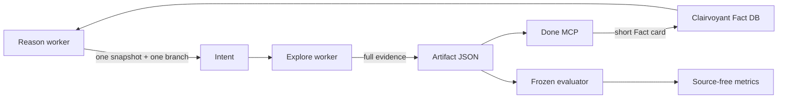

# Clairvoyant variant-search architecture and results

Private research export of the Clairvoyant-based Linux vulnerability-variant
search adapter and a source-free result snapshot.

## Current result snapshot

- Exported at: **2026-11-18 18:19 HKT**
- Exact-hunk historical location recall: **22 / 64 = 34.375%**
- Previous snapshot: **20 / 64 = 31.25%**
- Change: **+2 targets, +3.125 percentage points**
- Status: **provisional** — C7, C8, and C9 were still running at export time

“Hit” means that at least one accepted finding overlaps the frozen target's
changed function or exact changed hunk according to the benchmark evaluator. It
does not by itself mean that exploitability was confirmed.

## Repository layout

```text
adapter/                  Executable adapter, worker, Done MCP, prompts, tests
docs/ARCHITECTURE.md      Control flow, storage boundaries, recovery behavior
docs/RESULTS.md           Result interpretation and per-cluster summary
results/aggregate.json    Aggregate hit-rate snapshot
results/per_cluster.csv   Per-cluster metrics
results/exact_hits.csv    Exact-hit metadata without source text
results/runtime_progress.json
scripts/export_results.py Source-free result exporter
```

## Data boundary

This repository intentionally contains no Linux source snapshot, Git object,
source quote, raw finding reason, hidden evaluation manifest, Clairvoyant
database, checkpoint, model transcript, worker log, or API credential.

The adapter code is preserved so the scheduling and sandbox design can be
reviewed. Site-specific default paths in the adapter are configuration defaults,
not bundled data or credentials.

## High-level flow



See [docs/ARCHITECTURE.md](docs/ARCHITECTURE.md) for the detailed architecture
and [docs/RESULTS.md](docs/RESULTS.md) for result caveats.
